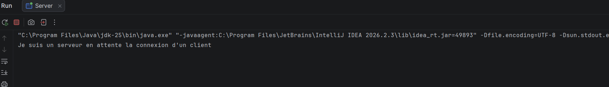
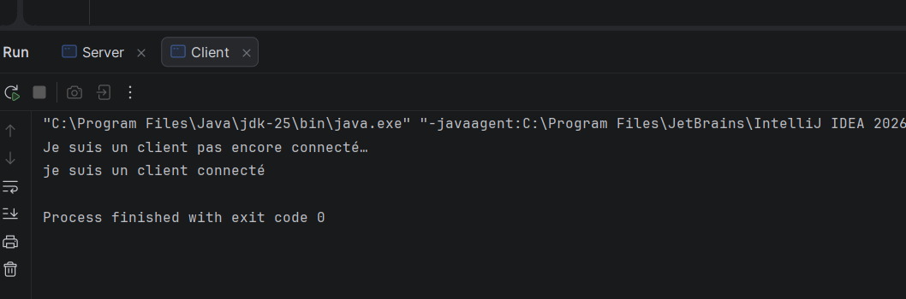
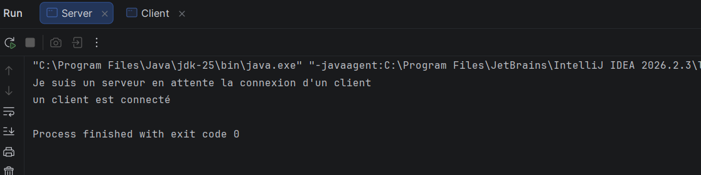
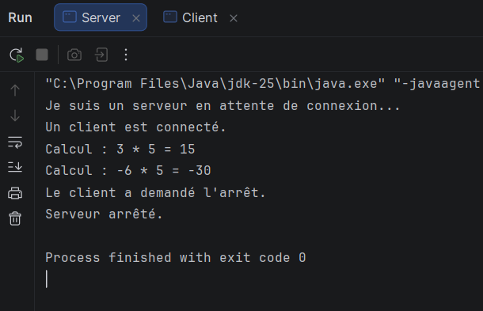
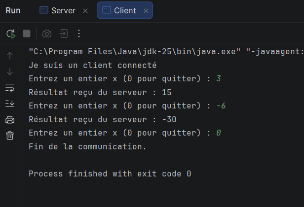

TP1-DAR2026 — Développement d’applications réparties

Étudiant : Fatma Mhadhbi  
Niveau : LSI3  
Année universitaire : 2026–2027

 Activité 1-1 : Première connexion Client/Serveur

 1. Objectif

L’objectif de cette activité est d’établir une connexion entre un client et un serveur en Java en utilisant les sockets TCP.

 2. Structure du projet

Le projet contient deux packages principaux :

- src/clientPackage/Client.java : application cliente.
- src/serverPackage/Server.java : application serveur.

 3. Fonctionnement

Le serveur utilise un objet ServerSocket sur le port 1234 et attend la connexion d’un client grâce à la méthode accept().

Le client établit une connexion avec le serveur en utilisant l’adresse localhost et le port 1234.

Lorsque la connexion est établie, le serveur et le client affichent des messages de confirmation dans leurs consoles respectives.

 4. Captures d’écran

 4.1. Serveur en attente d’une connexion

 4.2. Client connecté

 4.3. Connexion établie

 Activité 1-2 : Service de multiplication

 1. Objectif

L’objectif de cette activité est d’étendre l’application Client/Serveur développée dans l’Activité 1-1 afin d’ajouter un service de multiplication exécuté côté serveur.

Le serveur reçoit un entier envoyé par le client, calcule son produit par 5 et renvoie le résultat au client.

 2. Fonctionnement

Le traitement s’effectue selon les étapes suivantes :

1. Le client saisit un entier x au clavier.
2. Le client envoie cet entier au serveur à l’aide de DataOutputStream.
3. Le serveur reçoit le nombre à l’aide de DataInputStream.
4. Le serveur calcule le produit x * 5.
5. Le serveur envoie le résultat au client.
6. Le client reçoit et affiche le résultat.

Les classes DataInputStream et DataOutputStream permettent l’échange d’entiers entre les deux applications, y compris les valeurs négatives.

 3. Communication répétée

L’application est améliorée pour permettre au client de saisir plusieurs entiers successivement.

Après chaque saisie, le client envoie le nombre au serveur, reçoit le résultat de la multiplication par 5 et l’affiche.

Le traitement continue tant que le client saisit un entier différent de 0. Lorsque le client saisit 0, la communication s’arrête et les sockets sont fermées des deux côtés.

 4. Captures d’écran

 4.1. Calculs effectués côté serveur

 4.2. Résultats affichés côté client

 Conclusion générale

Ce TP a permis de découvrir et de mettre en pratique la communication Client/Serveur en Java à l’aide des sockets TCP.

L’Activité 1-1 a permis d’établir une première connexion entre un client et un serveur.

L’Activité 1-2 a permis d’étendre cette communication en ajoutant un service de multiplication exécuté côté serveur. L’utilisation de `DataInputStream` et de `DataOutputStream` a permis d’échanger des entiers entre les deux applications.

 Activité 1-3 : Amélioration du service de calculatrice

 Étape 1 : Communication entre deux machines

 1. Objectif

L’objectif de cette étape est d’établir une communication entre un client et un serveur exécutés sur deux machines distinctes connectées au même réseau local.

 2. Principe de fonctionnement

Dans les activités précédentes, la connexion entre le client et le serveur était établie à l’aide de l’adresse `localhost`.

Pour permettre la communication entre deux machines, il est nécessaire d’utiliser l’adresse IP de la machine sur laquelle le serveur s’exécute.

Le serveur utilise un objet `ServerSocket` pour écouter les connexions entrantes sur le port 1235. Le client utilise un objet `Socket` pour se connecter au serveur à l’aide de son adresse IP et du port correspondant.

Les classes `InetAddress` et `InetSocketAddress` permettent de manipuler les adresses réseau et de représenter l’adresse IP associée au port de communication.

 3. Configuration réseau

La machine virtuelle Ubuntu est utilisée dans VirtualBox. La configuration réseau doit permettre la communication entre la machine hôte et la machine virtuelle.

L’adresse IP de la machine Ubuntu peut être obtenue à l’aide de la commande suivante :

ip addr

L’adresse IP obtenue doit être utilisée dans le code du client si le serveur s’exécute sur Ubuntu.

Le port utilisé pour cette activité est le port 1235.

 4. Captures d’écran

 4.1. Configuration réseau de la machine virtuelle Ubuntu

 4.2. Adresse IP de la machine Ubuntu

 4.3. Serveur en attente d’une connexion

 4.4. Client connecté au serveur

 Étape 2 : Amélioration du service de calculatrice

 1. Objectif

L’objectif de cette étape est d’améliorer le service de calculatrice en ajoutant quatre opérations arithmétiques : l’addition, la soustraction, la multiplication et la division.

Le client permet à l’utilisateur de choisir une opération et de saisir les valeurs nécessaires. Le serveur effectue le calcul demandé et renvoie le résultat au client.

 2. Structure du projet

Pour conserver les classes développées dans les activités précédentes, deux nouvelles classes sont créées :

- `src/clientPackage/Client2.java` : application cliente.
- `src/serverPackage/Serveur2.java` : application serveur.

 3. Fonctionnement du client

Le client affiche un menu permettant de sélectionner l’opération souhaitée :

1. Addition
2. Soustraction
3. Multiplication
4. Division
0. Quitter

L’utilisateur choisit une opération, puis saisit deux nombres `x` et `y`.

Le client transmet au serveur le choix de l’opération ainsi que les deux nombres à l’aide de `DataOutputStream`.

Après le traitement effectué par le serveur, le client reçoit et affiche le résultat à l’aide de `DataInputStream`.

 4. Traitement effectué par le serveur

Le serveur reçoit le choix de l’opération et les deux nombres envoyés par le client.

Il utilise une structure `switch` pour sélectionner l’opération correspondante :

| Choix | Opération | Calcul |
|---|---|---|
| 1 | Addition | `x + y` |
| 2 | Soustraction | `x - y` |
| 3 | Multiplication | `x * y` |
| 4 | Division | `x / y` |

Le serveur envoie ensuite le résultat au client.

Une vérification est effectuée pour éviter la division par zéro. En cas d’erreur, le client affiche un message approprié.

Le choix `0` permet de terminer la communication et de fermer les flux ainsi que les sockets.

 5. Tests réalisés

Les tests permettent de vérifier le bon fonctionnement des quatre opérations et la communication entre le client et le serveur.

Exemples de calculs :

- Addition : `8 + 3 = 11`
- Soustraction : `8 - 3 = 5`
- Multiplication : `8 * 3 = 24`
- Division : `8 / 2 = 4`
- Division par zéro : affichage d’un message d’erreur.

 6. Captures d’écran

 6.1. Menu de la calculatrice côté client

 6.2. Résultat de l’addition

 6.3. Résultat de la soustraction

 6.4. Résultat de la multiplication

 6.5. Résultat de la division

 6.6. Gestion de la division par zéro

 6.7. Arrêt de la communication

 Conclusion de l’Activité 1-3

Cette activité a permis d’améliorer le service de calculatrice développé précédemment.

La première étape a porté sur la communication entre deux machines à l’aide des adresses IP et des sockets TCP.

La deuxième étape a permis d’ajouter quatre opérations arithmétiques et de traiter les demandes du client côté serveur. Elle a également permis de gérer les erreurs, notamment la division par zéro, et de fermer correctement la communication à la fin de l’exécution.
